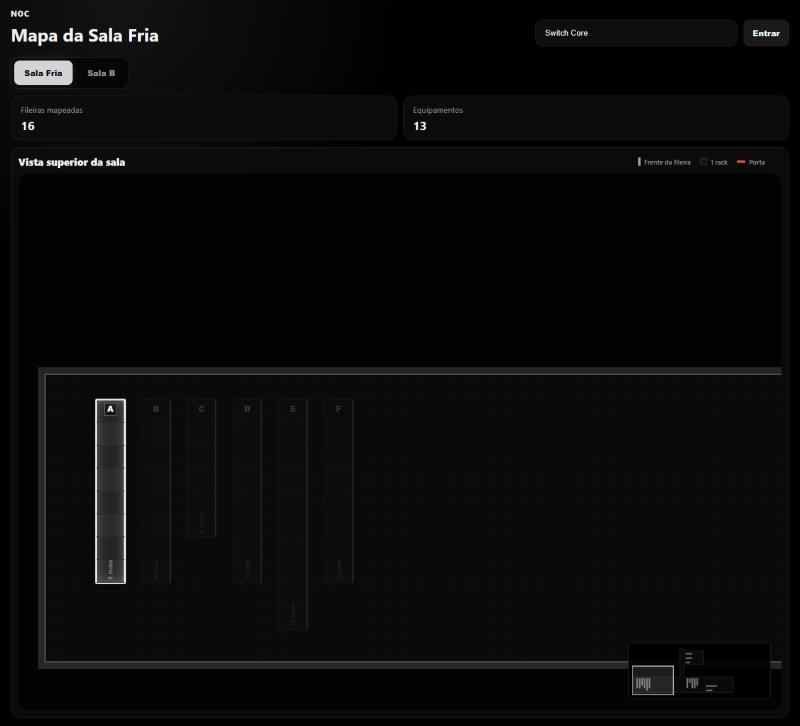
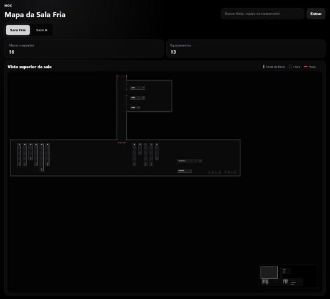
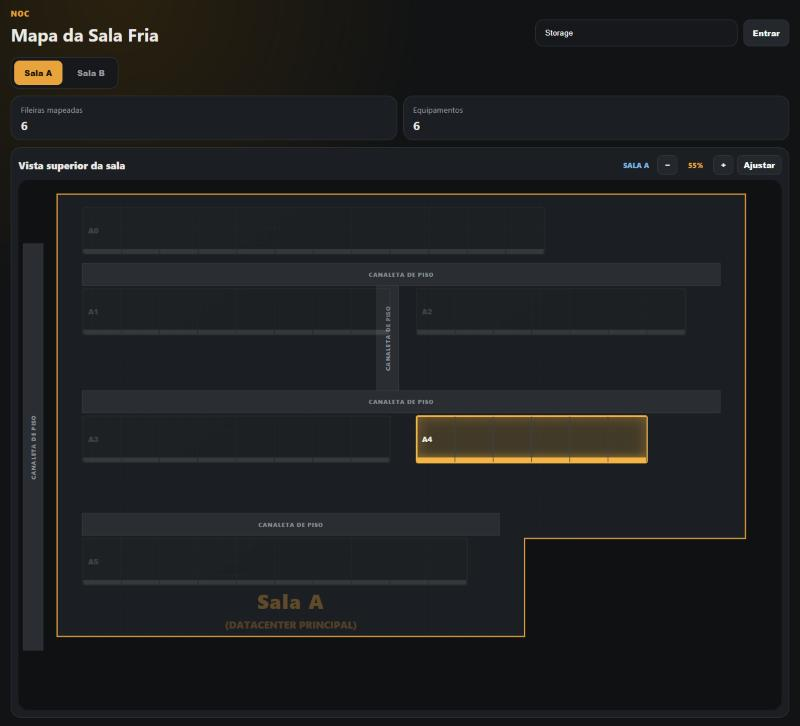
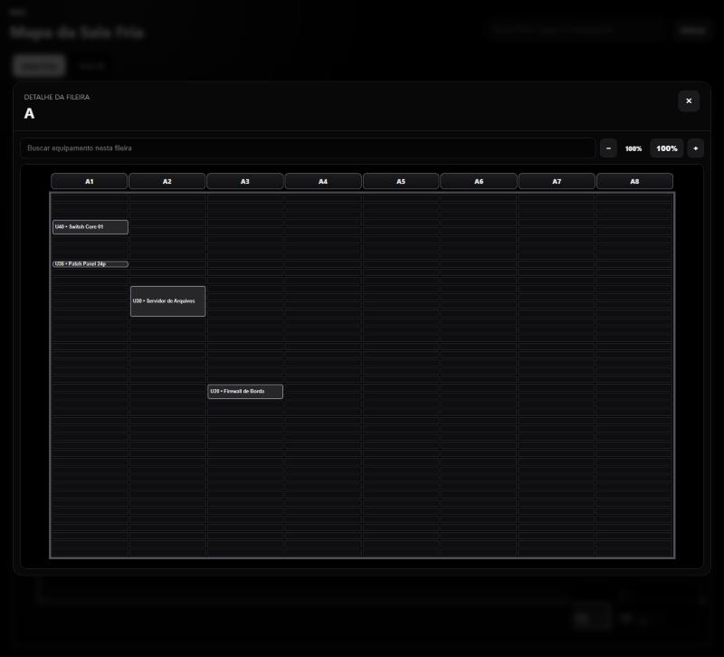
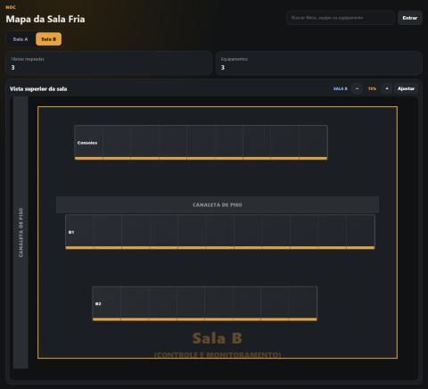

# Mapa de Equipamentos

Mapa web das salas técnicas (sala fria / datacenter) para localizar **fileiras**, **racks** e **equipamentos** sem precisar ir até a sala. Qualquer pessoa da rede abre o mapa no navegador para consultar; administradores entram com login para editar.

> Este repositório contém apenas a interface e o código. As plantas, fileiras e equipamentos que aparecem aqui são **fictícios** (dados de exemplo). Nenhum banco de dados real está versionado.



## O que dá para fazer

- **Ver a sala de cima**: fileiras desenhadas na planta, com uma divisória para cada rack e a frente da fileira marcada.
- **Buscar** por fileira, equipe, nome, modelo, número de série ou patrimônio: a fileira acende e o mapa vai até ela.
- **Abrir uma fileira** e ver cada rack de frente, com os equipamentos na posição exata (U inicial e altura em U).
- **Patch panels**: posições, conexões entre pontas e descrições manuais.
- **Documentos** por equipamento (fotos, diagramas, manuais, GMUD...).
- **Histórico** de todas as alterações (quem, quando, antes/depois), com filtros.
- **Vários usuários ao mesmo tempo**: as telas abertas se atualizam sozinhas quando alguém altera algo, e o servidor bloqueia edições em cima de dados desatualizados.
- **Modo consulta** sem login e **modo edição** para administradores (arrastar fileiras, criar/editar/excluir fileiras e equipamentos).

## Dois projetos, mesma base

| Pasta | Para quê | Destaques |
|---|---|---|
| [`sala-fria/`](sala-fria) | Sala já estabelecida, com fileiras de tamanho padrão | Sala principal + corredor + anexo em uma planta só, minimapa clicável, legenda, tema preto com destaque prata |
| [`area-tecnica/`](area-tecnica) | Área nova, desenhada a partir da planta baixa | Salas desenhadas com as coordenadas da planta (piso, canaletas), zoom de 30% a 130%, tema grafite e âmbar |

Nos dois, **o tamanho da fileira acompanha a quantidade de racks**: cada rack ocupa um tamanho fixo, então uma fileira de 10 racks tem o dobro do comprimento de uma de 5.

| Sala fria | Área técnica |
|---|---|
|  |  |
|  |  |

### Vocabulário

| Termo | Significado |
|---|---|
| **Fileira** | Uma linha de racks lado a lado no piso da sala |
| **Rack** | Um gabinete da fileira; cada rack tem 44U de altura útil |
| **U** | Unidade de altura de equipamento de rack (1U = 44,45 mm) |
| **Frente** | Lado da fileira por onde se acessa os equipamentos (linha colorida no mapa) |
| **Canaleta** | Canaleta de piso por onde passam os cabos (área técnica) |

## Como foi construído

- **Backend**: Python + [FastAPI](https://fastapi.tiangolo.com/) + SQLAlchemy, banco **SQLite** em modo WAL (um arquivo, sem servidor de banco).
- **Frontend**: HTML, CSS e JavaScript puros, sem framework e sem etapa de build. O FastAPI serve a pasta `frontend/` como arquivos estáticos.
- **Extensões em camadas**: o `index.html` traz o mapa base, e cada arquivo `.js` carregado depois acrescenta uma funcionalidade "embrulhando" as funções anteriores (`render`, `normalizeData`, `changeActiveRoom`...). Exemplo: `mapa-fileiras.js` recalcula o tamanho das fileiras antes de cada `render()`.
- **Planta em SVG**: `mapa-planta.js` desenha piso, paredes, portas e canaletas como uma camada única. As fileiras ficam por cima, posicionadas em % da sala.
- **Tema**: `mapa-tema.css` define as cores; `mapa-tema.js` troca as cores fixas dos estilos que os outros scripts criam, inclusive os criados depois.
- **Concorrência**: cada registro tem `versao_dados`; uma edição com versão antiga é recusada (409) e a tela avisa para recarregar.
- **Segurança**: senhas com PBKDF2-SHA256 (600 mil iterações, salt por usuário); sessão em cookie `HttpOnly` / `SameSite=Strict`, válida por 8 horas.
- **Atualizações**: o servidor responde com `Cache-Control: no-cache` e os scripts têm `?v=N` na URL, então uma atualização aparece com um F5.

```
sala-fria/  (e area-tecnica/, com a mesma estrutura)
├── backend/app/
│   ├── main.py            # FastAPI: rotas da API + arquivos do frontend
│   ├── database.py        # SQLite (WAL) e sessão do SQLAlchemy
│   ├── models/            # tabelas: fileiras, equipamentos, patch, documentos, histórico, administradores
│   ├── routers/           # rotas /api/...
│   ├── schemas/           # validação dos dados (Pydantic)
│   ├── services/          # regras de negócio (posição, conflitos, histórico)
│   └── security/          # senhas e sessões
├── frontend/
│   ├── index.html         # mapa base
│   ├── login.html
│   ├── mapa-planta.js     # planta da sala (SVG)
│   ├── mapa-fileiras.js / mapa-tema.*  # tamanho das fileiras e tema
│   └── *.js               # demais funcionalidades (busca, patch, histórico, documentos...)
├── scripts/
│   ├── criar_dados_exemplo.py   # popula um banco vazio com dados fictícios
│   └── criar_administrador.py   # cria ou atualiza um administrador
├── iniciar_servidor.cmd         # inicia o servidor na porta 8000
└── iniciar_servidor_oculto.vbs  # o mesmo, sem abrir janela
```

## Rodando na sua máquina

Requer Python 3.10 ou mais novo.

```bash
python -m venv .venv
.venv\Scripts\activate          # Windows  (Linux/macOS: source .venv/bin/activate)
pip install -r requirements.txt

cd sala-fria                    # ou area-tecnica
python scripts/criar_dados_exemplo.py
python scripts/criar_administrador.py   # opcional, para testar o modo edição
python -m uvicorn main:app --app-dir backend/app --port 8000
```

Abra <http://127.0.0.1:8000>. O banco é criado em `backend/data/sala_fria.db` na primeira execução.

## Como funciona nos computadores da empresa

- **Um computador Windows da rede** roda o servidor (`iniciar_servidor.cmd`, porta 8000, aberto para a rede local). Para subir junto com o Windows, agende `iniciar_servidor_oculto.vbs` no **Agendador de Tarefas** ("ao fazer logon"), ou rode pelo **Win+R** com `wscript.exe caminho\iniciar_servidor_oculto.vbs`.
- **Os demais computadores só usam o navegador**: `http://IP-DO-SERVIDOR:8000`. Não precisa instalar nada neles.
- **Consulta x edição**: qualquer um consulta sem login; quem é administrador entra em **Entrar** para editar. Administradores são criados no servidor com `scripts/criar_administrador.py` (a senha é digitada no terminal e só o hash vai para o banco).
- **Dados**: tudo fica em `backend/data/` (banco SQLite) e `backend/documentos/` (arquivos enviados). Para backup, copie o `.db` **junto** com os arquivos `-wal` e `-shm`.
- **Atualizar a versão**: copie as pastas `frontend/` e `backend/app/` novas por cima, **sem tocar em `backend/data/`**, e reinicie o servidor. As sessões ficam em memória, então reiniciar desloga os administradores.
- **Logs**: `backend/logs/inicializacao.log` e `backend/logs/uvicorn.log`.

## Adaptando para a sua sala

- **Sala fria**: o contorno (sala principal, corredor, anexo e portas) está em `ION_SALA_FRIA`, no início de `sala-fria/frontend/mapa-planta.js`, em pixels de um "mundo" de 4200 x 1500.
- **Área técnica**: as salas estão em `BH_PLANTA.salas`, no início de `area-tecnica/frontend/mapa-planta.js`, em unidades da planta (cerca de 236 unidades por metro). Dá para copiar as coordenadas de uma planta baixa em PDF vetorial: piso, canaletas e corredor de cada sala. O tamanho de um rack está em `BH_PLANTA.rack`.
- **Nomes das salas**: `ROOM_DEFINITIONS` em `frontend/rooms-ui.js` e o padrão `sala_key` em `backend/app/schemas/rack.py`.
- **Cores**: variáveis no topo de `frontend/mapa-tema.css` e a tabela de troca em `frontend/mapa-tema.js`.

## API (resumo)

| Rota | Uso |
|---|---|
| `GET /api/health` | Situação do servidor e do banco |
| `GET /api/dados/frontend` | Tudo que o mapa precisa (fileiras + equipamentos) |
| `GET /api/sync/version` | Versão dos dados (as telas usam para se atualizar) |
| `POST /api/auth/login`, `POST /api/auth/logout`, `GET /api/auth/me` | Sessão de administrador |
| `GET/POST /api/racks`, `PUT/DELETE /api/racks/{id}` | Fileiras |
| `PUT /api/racks/positions/batch` | Salvar posições depois de arrastar |
| `GET/POST /api/equipamentos`, `PUT/DELETE /api/equipamentos/{id}` | Equipamentos |
| `/api/equipamentos/{id}/patch...`, `/api/patch-connections...` | Patch panels e conexões |
| `/api/documentos...` | Documentos dos equipamentos |
| `GET /api/historico` | Histórico de alterações |

Com o servidor rodando, a documentação interativa completa fica em `/docs`.
